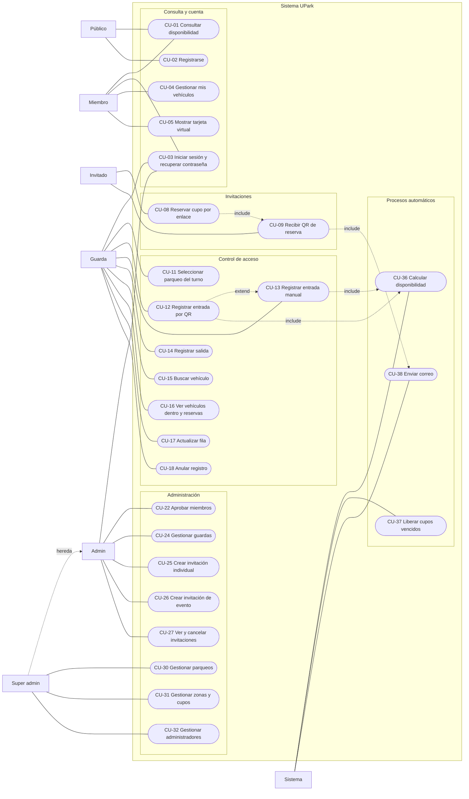

# Casos de uso de UPark

Este documento reúne los actores, el diagrama general y el catálogo de casos de uso. Las especificaciones detalladas de los casos **Must** están en los archivos de cada área; las reglas que citan (RN-xx) están en [reglas de negocio](../reglas-de-negocio.md).

Prioridades (MoSCoW):

- **Must:** entra en el prototipo del cuatrimestre.
- **Should:** entra si el tiempo alcanza.
- **Could:** ampliación futura.

## Actores

| Actor | Descripción |
|---|---|
| Público | Cualquier persona sin sesión. Solo consulta disponibilidad. |
| Miembro | Estudiante, profesor o funcionario de ULACIT con cuenta aprobada. Registra sus vehículos y entra con su tarjeta virtual. |
| Invitado | Persona externa (visita, evento, consultorio dental) que recibe un enlace de invitación y reserva un cupo. No tiene cuenta. |
| Guarda | Opera el acceso de un parqueo: registra entradas y salidas, busca vehículos y actualiza la fila. |
| Admin | Aprueba miembros, gestiona guardas y crea invitaciones. |
| Super admin | Todo lo del admin, más la configuración de parqueos, zonas, cupos y administradores. |
| Organizador | Profesor o doctor que coordina una actividad y genera invitaciones. **A definir; fuera de esta fase.** |
| Sistema | Procesos automáticos: cálculo de disponibilidad, liberación de cupos y envío de correos. |

El super admin hereda todos los casos del admin. Miembro, guarda, admin y super admin comparten el caso de inicio de sesión (CU-03).

## Diagrama

Notas del diagrama:

- `include`: el caso siempre ejecuta el otro (por ejemplo, reservar siempre genera el QR).
- `extend`: el caso puede derivar en el otro (si el QR falla, el guarda pasa a la entrada manual).
- Solo aparecen los casos **Must**. Los demás están en el catálogo.

## Catálogo completo

### Público

| ID | Caso | Prioridad |
|---|---|---|
| CU-01 | Consultar disponibilidad por parqueo y zona | Must |

### Miembro

| ID | Caso | Prioridad |
|---|---|---|
| CU-02 | Registrarse con correo institucional | Must |
| CU-03 | Iniciar y cerrar sesión, recuperar contraseña | Must |
| CU-04 | Gestionar mis vehículos | Must |
| CU-05 | Mostrar mi tarjeta virtual (QR) | Must |
| CU-06 | Solicitar condición preferencial | Should |
| CU-07 | Ver mi historial de ingresos | Could |

### Invitado

| ID | Caso | Prioridad |
|---|---|---|
| CU-08 | Reservar cupo por enlace de invitación | Must |
| CU-09 | Recibir el QR de la reserva | Must |
| CU-10 | Cancelar mi reserva | Should |

### Guarda

| ID | Caso | Prioridad |
|---|---|---|
| CU-11 | Seleccionar el parqueo del turno | Must |
| CU-12 | Registrar entrada por QR | Must |
| CU-13 | Registrar entrada manual | Must |
| CU-14 | Registrar salida | Must |
| CU-15 | Buscar vehículo por placa o identificación | Must |
| CU-16 | Ver vehículos dentro y reservas del día | Must |
| CU-17 | Actualizar la fila | Must |
| CU-18 | Anular un registro | Must |
| CU-19 | Ajustar la ocupación a mano | Should |
| CU-20 | Registro diferido tras una caída | Should |
| CU-21 | Verificar condición preferencial de una visita | Should |

### Admin

| ID | Caso | Prioridad |
|---|---|---|
| CU-22 | Aprobar o rechazar miembros | Must |
| CU-23 | Aprobar condición preferencial | Should |
| CU-24 | Gestionar guardas | Must |
| CU-25 | Crear invitación individual | Must |
| CU-26 | Crear invitación de evento | Must |
| CU-27 | Ver y cancelar invitaciones y reservas | Must |
| CU-28 | Reporte de ocupación por zona y franja | Should |
| CU-29 | Revisar auditoría de anulaciones y ajustes | Should |

### Super admin

| ID | Caso | Prioridad |
|---|---|---|
| CU-30 | Gestionar parqueos | Must |
| CU-31 | Gestionar zonas y cupos | Must |
| CU-32 | Gestionar administradores | Must |
| CU-33 | Configurar parámetros del sistema | Should |
| CU-34 | Editar catálogos de tamaños y tipos de persona | Could |

### Organizador

| ID | Caso | Prioridad |
|---|---|---|
| CU-35 | Generar invitaciones para su actividad | Could |

### Sistema

| ID | Caso | Prioridad |
|---|---|---|
| CU-36 | Calcular disponibilidad por zona y tamaño | Must |
| CU-37 | Liberar cupos vencidos | Must |
| CU-38 | Enviar correos (QR, aprobaciones, invitaciones) | Must |
| CU-39 | Cerrar movimientos abiertos al final del día | Should |
| CU-40 | Borrar datos personales vencidos (Ley 8968) | Should |
| CU-41 | QR rotativo o NFC | Could |
